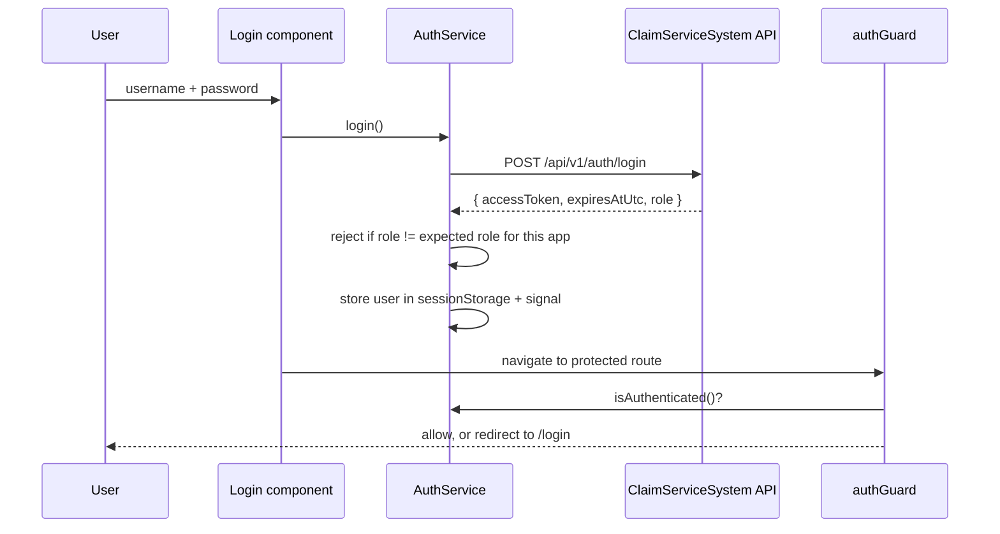

# Claims Workspace – Frontend Documentation

## 1. Overview

The Claims Workspace is an Angular 20 multi-project workspace that provides two separate portals for an insurance claims system, backed by the `ClaimServiceSystem` .NET 8 API.

| Requirement area | Portal |
|---|---|
| Claimants report an incident, track their claim, provide additional information when asked, and receive decisions. | **claimant-app** |
| Claims staff pick up incoming claims, review and assess them, progress claims to settlement or rejection, and see team workload and performance. | **staff-app** |

Both apps share models, services, and UI components through the **claims-shared** library.

## 2. Tech Stack

| Concern | Choice |
|---|---|
| Framework | Angular 20 (standalone components, no NgModules) |
| State | Angular signals (`signal`, `computed`) |
| HTTP | `HttpClient` with functional interceptors |
| Routing | Standalone router with functional guards |
| Styling | Bootstrap 5 (global CSS/JS via `angular.json`) + SCSS |
| Backend | ASP.NET Core 8 Web API, EF Core + SQLite, JWT auth |

## 3. Workspace Structure

```
claims-workspace/
├── angular.json            # 3 projects: claimant-app, staff-app, claims-shared
├── tsconfig.json           # path alias "claims-shared" -> projects/claims-shared/src/public-api.ts
└── projects/
    ├── claimant-app/       # Claimant portal (port 4200)
    ├── staff-app/          # Staff portal (port 4201)
    └── claims-shared/      # Shared library
```

### 3.1 Application layout (both apps)

```
src/
├── environments/           # environment.ts (dev) / environment.prod.ts (prod)
└── app/
    ├── app.config.ts       # Router, HttpClient + interceptor, API_BASE_URL provider
    ├── app.routes.ts       # Route table
    ├── core/
    │   ├── auth/           # AuthService + Login component
    │   ├── guards/         # authGuard
    │   └── interceptors/   # authInterceptor (adds Bearer token)
    ├── layouts/
    │   ├── auth-layout/    # Centered shell for the login page
    │   └── claimant-layout | staff-layout   # Navbar shell for authenticated pages
    └── features/           # One folder per feature page
```

### 3.2 Shared library (`claims-shared`)

| Folder | Contents |
|---|---|
| `models/` | `user`, `claim`, `claim-status`, `assessment`, `decision` |
| `services/` | `ClaimsApiService`, `ReferenceDataService`, `NotificationService` |
| `components/` | `claim-status-badge`, `claim-timeline`, `confirmation-dialog`, `loading-spinner` |
| `tokens/` | `API_BASE_URL` injection token |
| `utilities/` | `date.utils`, `error.utils` |

Everything public is exported from `projects/claims-shared/src/public-api.ts`. The `tsconfig.json` path alias points at the library **source**, so apps pick up library changes live without building the library first.

## 4. Routing

### claimant-app

| Path | Component | Guarded |
|---|---|---|
| `/login` | `Login` (in `AuthLayout`) | No |
| `/my-claims` | `MyClaims` | Yes |
| `/submit-claim` | `SubmitClaim` | Yes |
| `/claim-details/:id` | `ClaimDetails` | Yes |
| `/provide-information/:id` | `ProvideInformation` | Yes |
| `/` | redirects to `/my-claims` | Yes |
| `**` | redirects to `/login` | – |

### staff-app

| Path | Component | Guarded |
|---|---|---|
| `/login` | `Login` (in `AuthLayout`) | No |
| `/dashboard` | `Dashboard` | Yes |
| `/claims-queue` | `ClaimsQueue` | Yes |
| `/my-claims` | `MyClaims` | Yes |
| `/claim-details/:id` | `ClaimDetails` | Yes |
| `/team-overview` | `TeamOverview` | Yes |
| `/` | redirects to `/dashboard` | Yes |
| `**` | redirects to `/login` | – |

`AuthLayout` is mounted at `/login` (not `''`) so that the root path falls through to the guarded layout.

## 5. Authentication Flow



| Item | claimant-app | staff-app |
|---|---|---|
| Expected role | `Claimant` | `ClaimStaff` |
| sessionStorage key | `claimant.auth` | `staff.auth` |

- **`AuthService`** – exposes `currentUser` and `isAuthenticated` signals, `login()`, `logout()`, `getToken()`.
- **`authGuard`** – returns `true` when authenticated, otherwise a `UrlTree` to `/login`.
- **`authInterceptor`** – attaches `Authorization: Bearer <token>` only to requests whose URL starts with `API_BASE_URL`, so tokens are never leaked to third-party hosts.

## 6. Configuration

### API base URL

The shared library cannot import an app's `environment` file, so the base URL is supplied via an `InjectionToken`:

```ts
// claims-shared
export const API_BASE_URL = new InjectionToken<string>('API_BASE_URL');

// app.config.ts (each app)
{ provide: API_BASE_URL, useValue: environment.apiBaseUrl }
```

| Environment | `apiBaseUrl` |
|---|---|
| Development (`environment.ts`) | `https://localhost:7132/api/v1` |
| Production (`environment.prod.ts`) | `/api/v1` (same-origin, behind a reverse proxy) |

`environment.prod.ts` is swapped in through `fileReplacements` in `angular.json`.

### Backend CORS

The API has a `LocalClients` CORS policy allowing `http://localhost:4200` and `http://localhost:4201`.

## 7. Running Locally

Prerequisites: Node.js + npm, .NET 8 SDK, trusted ASP.NET dev certificate (`dotnet dev-certs https --trust`).

```powershell
# 1. Backend
cd C:\Users\s7690f\source\repos\ClaimServiceSystem\ClaimServiceSystem
dotnet run --launch-profile https            # https://localhost:7132

# 2. Frontend (separate terminals)
cd C:\Users\s7690f\source\repos\claims-workspace
npm install
node_modules\.bin\ng.cmd serve claimant-app  # http://localhost:4200
node_modules\.bin\ng.cmd serve staff-app     # http://localhost:4201
```

> On Windows PowerShell, `npx ng ...` may fail with "could not determine executable to run". Use `node_modules\.bin\ng.cmd` instead.

### Seeded development users

| App | Username | Password |
|---|---|---|
| claimant-app | `claimant1` | `Pass@123` |
| staff-app | `staff1` | `Pass@123` |

### Build and test

```powershell
node_modules\.bin\ng.cmd build claims-shared
node_modules\.bin\ng.cmd build claimant-app
node_modules\.bin\ng.cmd build staff-app
node_modules\.bin\ng.cmd test <project>
```

## 8. Current Status

| Area | Status |
|---|---|
| Workspace, projects, shared library | Done |
| Login, role check, guard, interceptor | Done (both apps) |
| Layouts and navigation | Done |
| Feature pages | Placeholders – headings only, not yet wired to the API |
| Shared `ClaimsApiService` | `getClaims()`, `getClaim(id)` only |

### Suggested next steps

1. Implement claimant features: list claims, submit claim form, claim details with timeline, respond to information requests.
2. Implement staff features: claims queue (pick up), assessment and decision forms, team workload dashboard.
3. Extend `ClaimsApiService` to match the backend endpoints.
4. Handle token expiry (`expiresAtUtc`) and HTTP 401 responses with automatic logout.
5. Add unit tests for `AuthService`, `authGuard`, and `authInterceptor`.
